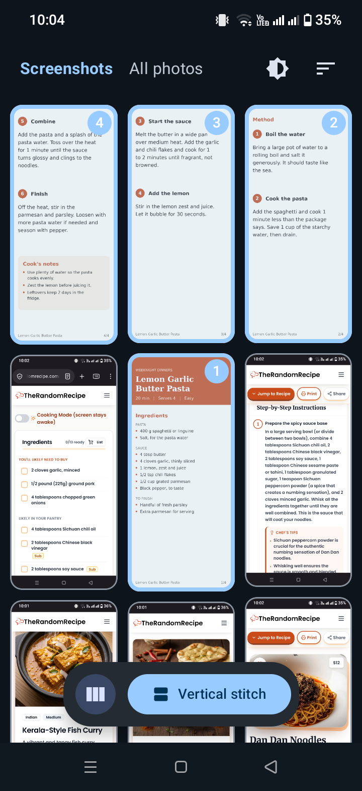
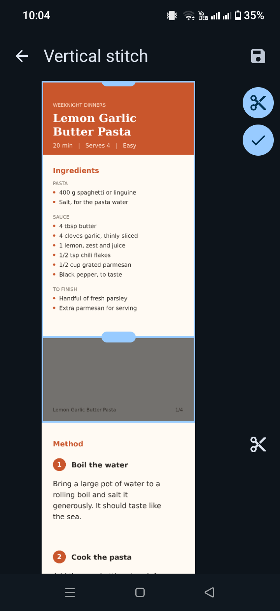
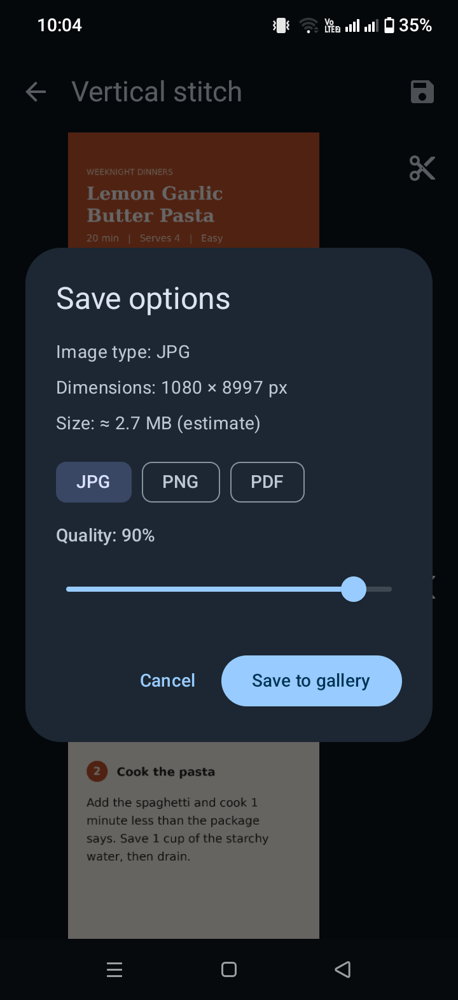

<div align="center">

# Stitchpix

**Stitch photos and screenshots into one seamless image.**

Pick, order, crop, and export in seconds. Native Android, built with Kotlin and Jetpack Compose.

[](https://github.com/mastah123/stitchpix/releases/latest)
[](https://github.com/mastah123/stitchpix/actions/workflows/build.yml)


[](LICENSE)

</div>

<p align="center">
  
  
  
</p>


## Install

1. Open the [latest release](https://github.com/mastah123/stitchpix/releases/latest) on your Android phone.
2. Download the APK.
3. Open it and allow **Install unknown apps** for your browser if prompted.

Requires Android 8.0 (API 26) or newer.

## Features

**Pick**
- Gallery picker with **Screenshots** (default) and **All photos** tabs
- Sort by recent, oldest, or name
- 3-column masonry grid
- Numbered multi-select that renumbers as you deselect

**Stitch**
- Vertical or horizontal stitching with 2+ images
- Scrollable live preview

**Edit**
- Per-image cut tool
- Crop handles that adapt to layout (top/bottom for vertical, left/right for horizontal)

**Export**
- JPG, PNG, or PDF
- JPG quality slider
- Dimensions and estimated file size shown before saving
- One-tap **Save to gallery**

**Polish**
- Light, dark, or system theme
- Adaptive launcher icon with themed monochrome variant
- Splash screen

## Usage

1. Grant photo access.
2. Tap images in the order you want.
3. Choose **Vertical stitch** or the horizontal stitch icon.
4. Optionally cut or crop.
5. Tap the check button, choose a format, and save.

| Format | Saved to |
|--------|----------|
| JPG / PNG | `Pictures/Stitch` |
| PDF | `Documents/Stitch` |

## Tech Stack

| Area | Technology |
|------|------------|
| Language | Kotlin |
| UI | Jetpack Compose |
| Build | Gradle (Kotlin DSL) |
| CI/CD | GitHub Actions |
| Toolchain | JDK 17, Android SDK 34 |

## Build from Source

```bash
git clone https://github.com/mastah123/stitchpix.git
cd stitchpix
gradle assembleDebug
```

Requires JDK 17, Android SDK 34, and Gradle 8.7. The APK is written to `app/build/outputs/apk/debug/`. You can also open the project in Android Studio and run it directly.

## CI/CD

| Workflow | Trigger | Output |
|----------|---------|--------|
| `build.yml` | Push to any branch, pull requests, manual | Debug APK, available as the **stitchpix-debug-apk** artifact |
| `release.yml` | Publishing a release or pushing a `v*` tag | Signed release APK and debug APK attached to the release |

<details>
<summary><strong>Release signing setup</strong></summary>

<br>

Debug builds use the fixed key in `app/debug.keystore` (public password `android`) so CI builds install over each other. Never use it for store releases.

Release builds are signed with a private key stored in GitHub Secrets (**Settings → Secrets and variables → Actions**):

| Secret | Value |
|--------|-------|
| `KEYSTORE_BASE64` | Base64-encoded release keystore |
| `KEYSTORE_PASSWORD` | Keystore password |
| `KEY_ALIAS` | Key alias |
| `KEY_PASSWORD` | Key password |

To release, create a tag and push it:

```bash
git tag v1.0.0
git push origin v1.0.0
```

</details>

## Project Structure

```
stitchpix/
├── app/                  # Android application module
├── .github/workflows/    # Build and release pipelines
├── LICENSE               # MIT License
├── CHANGELOG.md          # Version history
├── PROJECT_CONTEXT.md    # Architecture notes and manual test checklist
├── build.gradle.kts
├── settings.gradle.kts
└── gradle.properties
```

## Testing

No automated tests yet. A manual QA checklist is in [`PROJECT_CONTEXT.md`](PROJECT_CONTEXT.md).

## Roadmap

- [ ] Automated unit and UI tests
- [ ] Commit a Gradle wrapper
- [ ] Demo GIF in this README

## Changelog

See [CHANGELOG.md](CHANGELOG.md).

## License

Released under the [MIT License](LICENSE).

## Author

Built by [@mastah123](https://github.com/mastah123).
